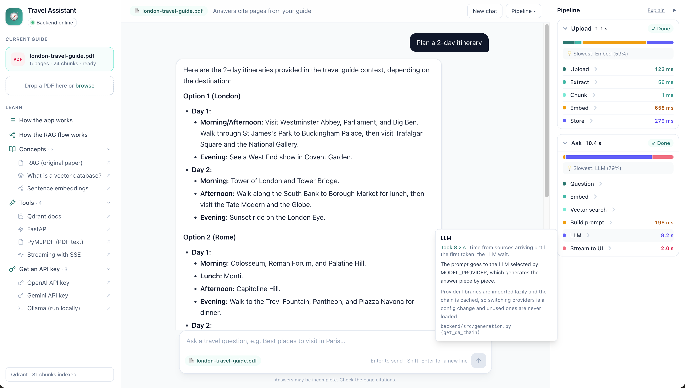
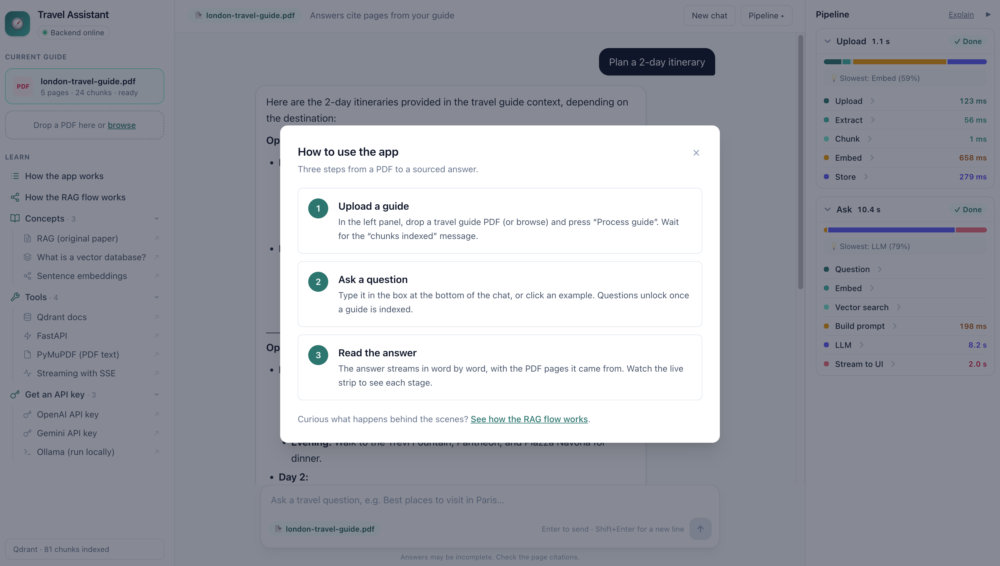
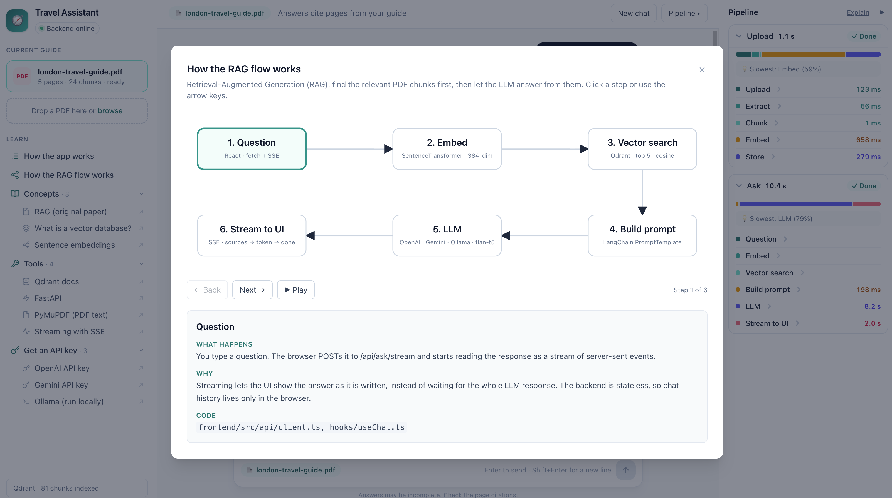
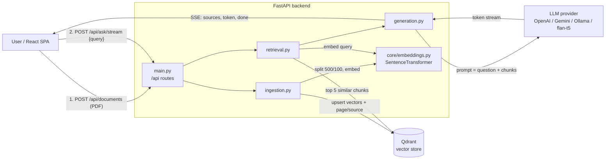

# AI Travel Assistant

[](https://github.com/RiteshAryal/ai-travel-assistent/actions/workflows/ci.yml)
[](LICENSE)

A Retrieval-Augmented Generation (RAG) app that answers travel questions from **your own PDF guides**. Upload a city guide, ask "Best places to visit in Paris", and get a streamed answer with page citations, grounded in the document rather than the LLM's general knowledge.



## Highlights

- **Grounded answers with citations**: every answer is generated only from the top 5 retrieved chunks, and the source pages are returned with it.
- **Token streaming over SSE**: sources arrive first, then tokens, so the UI can show citations while the answer is still being written.
- **Live pipeline view**: the UI shows every stage of upload (extract, chunk, embed, store) and ask (embed, vector search, build prompt, LLM, stream) with timings, highlights the slowest stage and flags failed steps.
- **Built-in guided tour**: in-app "How the app works" and interactive "How the RAG flow works" explainers, plus links to learning resources.
- **Swappable LLM**: OpenAI, Gemini, Ollama (local) or Hugging Face flan-t5, selected with one env var.
- **Idempotent ingestion**: deterministic chunk IDs (`uuid5(source:page:idx)`), so re-uploading a PDF overwrites instead of duplicating.
- **Runs with zero cloud setup**: `QDRANT_HOST=:memory:` runs an in-process vector store; embeddings are computed locally.
- **Tested without real models**: backend tests use in-memory Qdrant, a fake embedder and a fake chat model, so they are fast and need no API keys.

## Screenshots

**How the app works**: a three-step guide (upload, ask, read the answer). The right-hand panel shows live per-stage timings for upload and ask.



**How the RAG flow works**: an interactive walkthrough of the six steps (question, embed, vector search, build prompt, LLM, stream to UI), with what happens, why, and the source files for each step.



## Tech stack

| Layer | Technology |
|-------|------------|
| Frontend | React, TypeScript, Vite, Vitest, oxlint |
| Backend | Python, FastAPI, LangChain, PyMuPDF |
| Embeddings | SentenceTransformers (384-dim, local) |
| Vector store | Qdrant (cloud or in-memory) |
| LLM | OpenAI, Gemini, Ollama or HF flan-t5 |
| Tests | pytest, Vitest |

## Architecture



**Ingestion**: PDF pages are extracted with PyMuPDF, split into 500-character chunks with 100 overlap, embedded locally and upserted into Qdrant with `{text, page, source}`.

**Question answering**: the query is embedded, Qdrant returns the 5 nearest chunks, and the LLM answers from those chunks only. The backend is stateless; chat history lives in the browser.

More detail: [docs/architecture.md](docs/architecture.md), [docs/frontend-architecture.md](docs/frontend-architecture.md), API contract.

## Design decisions

- **Local embeddings**: no per-request embedding cost and no data leaves the machine for retrieval.
- **Deterministic IDs**: makes re-upload safe and idempotent without a separate dedupe step.
- **Sync `/ask` endpoint**: the chain call is blocking, so FastAPI runs it in its threadpool instead of blocking the event loop.
- **Provider-agnostic generation**: provider libraries are imported lazily, so only the one you choose needs to be installed and configured.
- **Collection safety check**: startup fails if the existing Qdrant collection has a different vector size than the embedding model, instead of silently returning bad results.

## Getting started

### Prerequisites

Python 3.10+, Node.js 22, and one LLM option: a Gemini key (free tier), an OpenAI key, a local Ollama, or the local flan-t5 model.

### Backend

```bash
cd backend
python3 -m venv .venv
.venv/bin/pip install -r requirements.txt
cp .env.example .env
```

Edit `backend/.env`:

- `MODEL_PROVIDER`: `gemini` (`GEMINI_API_KEY`), `openai` (`OPENAI_API_KEY`), `ollama` (`OLLAMA_BASE_URL`, `OLLAMA_MODEL`) or `huggingface`
- `QDRANT_HOST=:memory:` for zero-setup (data lost on restart), or your Qdrant Cloud URL plus `QDRANT_API_KEY`

```bash
.venv/bin/uvicorn src.main:app --reload     # http://localhost:8000
```

Health check: <http://localhost:8000/api/health>. First start downloads the embedding model, so it can take a minute.

### Frontend

```bash
cd frontend
npm install
npm run dev                                 # http://localhost:5173
```

Upload `data/paris-travel-guide.pdf` from the sidebar (London and Rome guides are in `data/` too), then ask "Best places to visit in Paris".

## API

| Method | Path | Description |
|--------|------|-------------|
| GET | `/api/health` | Liveness check |
| POST | `/api/documents` | Multipart `file` (PDF); ingests into Qdrant |
| POST | `/api/ask` | `{query}` returns `{response, sources}` |
| POST | `/api/ask/stream` | SSE events `sources`, `token`, `done`, `error` |

Errors are returned as 4xx/5xx `{detail}`.

## Tests

```bash
cd backend && .venv/bin/pip install -r requirements-dev.txt && .venv/bin/python -m pytest
cd frontend && npm test && npm run lint
```

## Known limitations

- **No authentication**: do not expose the backend publicly.
- If a same-named PDF is re-uploaded with fewer chunks, stale chunks from the earlier version remain.
- Changing `EMBEDDING_MODEL` changes the vector size; use a new `COLLECTION_NAME`.
- Chat history is browser-only and is not persisted.

## License

[MIT](LICENSE)

## Author

Ritesh Aryal. [GitHub](https://github.com/RiteshAryal)
