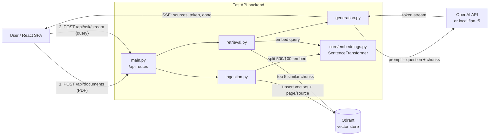

# Architecture

## Purpose

The assistant answers travel questions **grounded in documents you upload** (PDF guides) instead of relying on the LLM's general knowledge. This is Retrieval-Augmented Generation (RAG): find the most relevant passages first, then have the LLM answer using only those passages, with page citations.

Why this design:

- **Qdrant** stores text chunks as vectors so we can search by meaning, not keywords.
- **Embedding model** (SentenceTransformer, 384-dim, runs locally) turns text and questions into vectors.
- **LLM** (OpenAI, or local HF flan-t5) writes the final answer from the retrieved context.
- **FastAPI backend** is stateless; chat history lives only in the browser.

## Diagram

## Flows

### 1. Ingestion (upload a PDF)

1. Frontend sends the PDF to `POST /api/documents`.
2. `ingestion.py` extracts text per page (PyMuPDF) and splits it into 500-char chunks with 100 overlap.
3. Each chunk is embedded locally.
4. Chunks are written to Qdrant with payload `{text, page, source}`. IDs are deterministic (`uuid5(source:page:idx)`), so re-uploading the same file overwrites instead of duplicating.

### 2. Question answering

1. Frontend sends `{query}` to `POST /api/ask/stream` (or `/api/ask` for a single JSON reply).
2. `retrieval.py` embeds the query and asks Qdrant for the top 5 nearest chunks.
3. `generation.py` builds a prompt from the question plus those chunks and calls the LLM.
4. Response streams back as SSE events: `sources` (chunks + pages), many `token`, then `done` (or `error`).

## Components

| Component | Role |
|-----------|------|
| `frontend/` | React + Vite UI: upload, chat, streamed answer, source citations |
| `backend/src/main.py` | Routes, CORS, startup (creates collection, preloads models) |
| `backend/src/ingestion.py` | PDF to chunks to vectors to Qdrant |
| `backend/src/retrieval.py` | Vector search, returns `{text, page, source, score}` |
| `backend/src/generation.py` | Prompt + LLM chain, sync and streaming |
| `backend/src/core/embeddings.py` | Cached embedding model |
| Qdrant | Vector DB (cloud, or `:memory:` for local dev) |
| OpenAI / flan-t5 | Answer generation, chosen by `MODEL_PROVIDER` |

## Constraints

- Changing `EMBEDDING_MODEL` changes vector size; use a new `COLLECTION_NAME`.
- No auth: do not expose the backend publicly.
