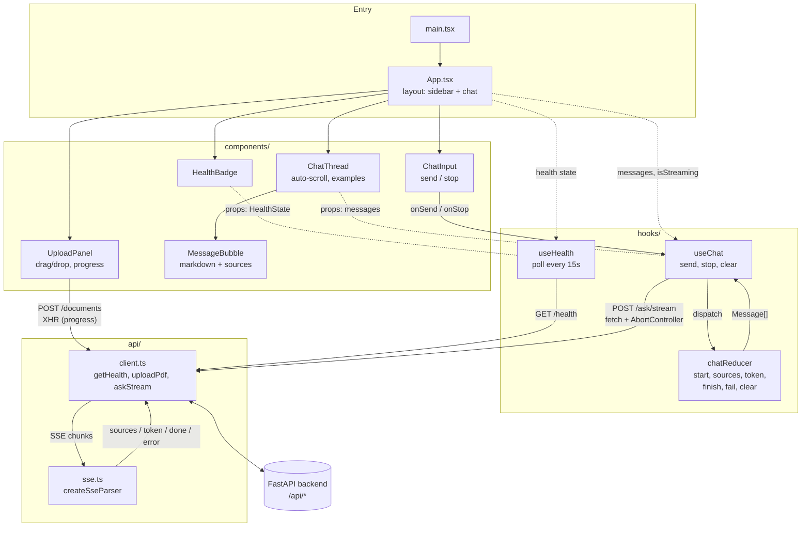
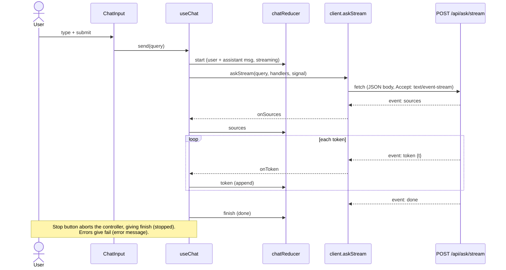

# Frontend Architecture

React + Vite + TypeScript SPA in `frontend/`. No router, no global store: `App.tsx` composes two hooks and four components. Chat state lives in the browser only; the backend is stateless.

## Diagram

## Layers

| Layer | Files | Role |
|-------|-------|------|
| Entry | `main.tsx`, `App.tsx` | Mount, layout, wire hooks to components |
| Components | `components/*.tsx` | Presentational UI; `UploadPanel` owns its own upload state |
| Hooks | `hooks/useChat.ts`, `hooks/useHealth.ts` | Async orchestration, expose state to `App` |
| State | `hooks/chatReducer.ts` | Pure reducer for `Message[]` (status: `streaming`, `done`, `stopped`, `error`) |
| API | `api/client.ts`, `api/sse.ts` | All HTTP; error normalisation to `ApiError`; SSE parsing |

## Flows

### Ask a question (streaming)

### Upload a PDF

`UploadPanel` calls `uploadPdf(file, onProgress)`, which uses XHR (fetch has no upload progress) against `POST /api/documents`. Size is checked client-side against `VITE_MAX_UPLOAD_MB` when set.

### Health

`useHealth` calls `getHealth` immediately and every 15s. `status === 'ok'` gives `ok`, other status gives `degraded`, network failure gives `down`. Polling stops on unmount via `AbortController`.

## Design notes

- **Single in-flight request:** `useChat` guards with `controllerRef`; `send` is a no-op while streaming.
- **Dev proxy:** Vite proxies `/api` to `:8000`; `VITE_API_URL` is empty in dev and set for deployed builds.
- **Tests:** `chatReducer.test.ts` and `sse.test.ts` cover the pure logic (vitest).

See [architecture.md](architecture.md) for the full-stack view.
